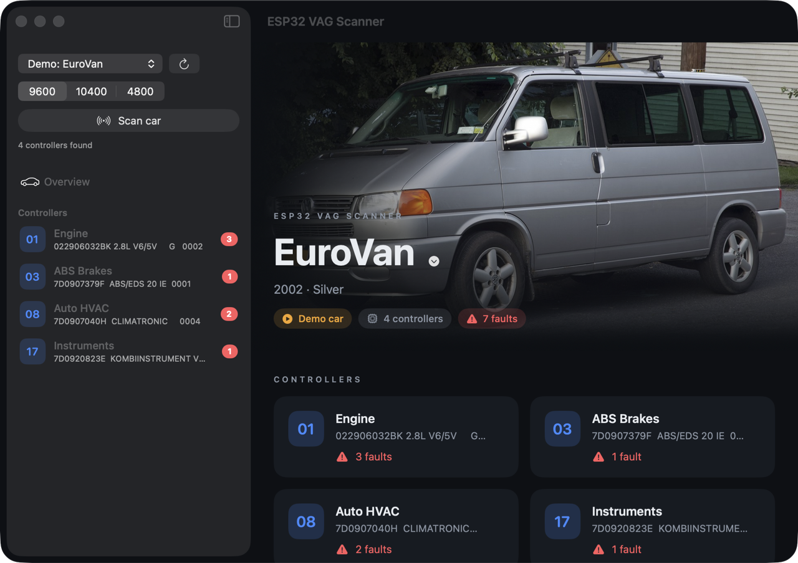
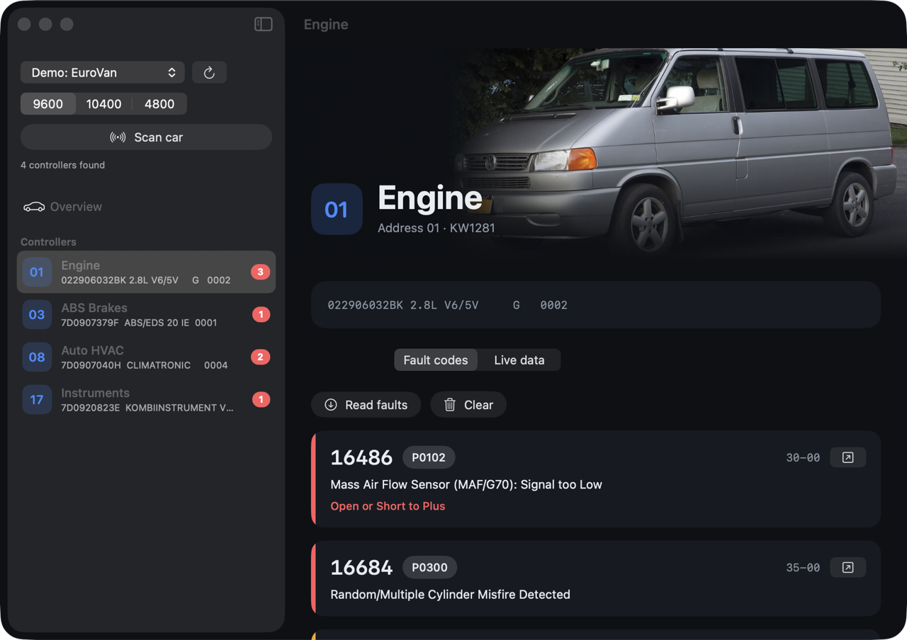
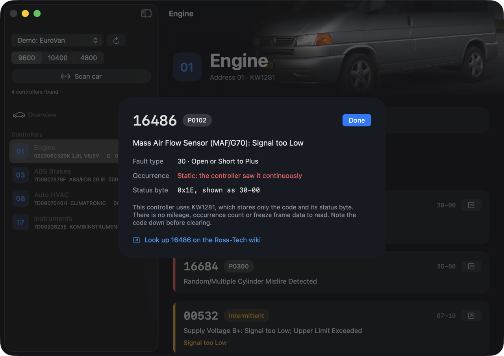
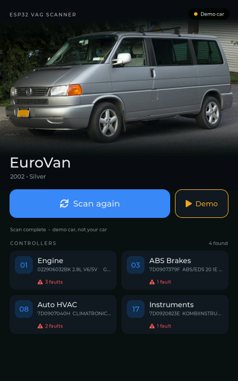
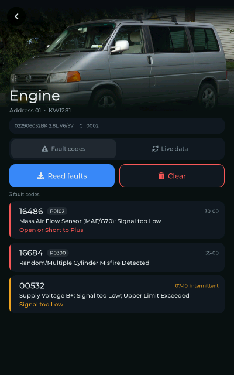
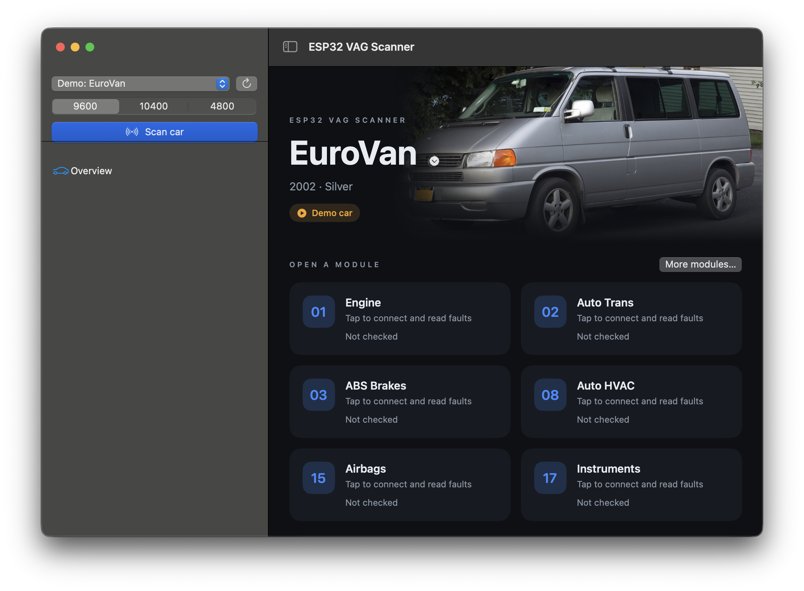

# ESP32 VAG Scanner

Read older VW and Audi controllers with a cheap KKL USB cable. Scan the car's modules, read
identification, read and clear fault codes, and watch live measuring blocks. It speaks
**KW1281**, the K-line protocol used by VAG cars from about 1990 to 2004.

There are two front ends, both driving the same cable with the same protocol core:

- **macOS**: a SwiftUI app.
- **ESP32-P4**: a standalone touch-screen unit (Guition JC8012P4A1C). The KKL cable plugs
  into the P4's USB port, with no wiring.

> **Status:** everything works against the built-in simulated car, and the P4 firmware
> runs on hardware. It has **not yet been tested on a real car**.

## Screenshots

### macOS

| Overview | Fault codes |
|---|---|
|  |  |

Click a fault for everything the controller stores about it:



### ESP32-P4

| Home | Fault codes |
|---|---|
|  |  |

All screenshots show the simulated EuroVan (demo mode).

## Features

- Open a module directly from the landing screen and automatically read its fault codes,
  without scanning the car first. Both apps show **01 Engine**, **02 Transmission**,
  **03 ABS**, **08 HVAC**, **15 Airbags**, and **17 Instruments**, with **More modules** for
  the remaining known addresses. Identification and faults use one connection.
- Scan for controllers (common addresses, or all of 01-7F).
- Controller identification (part number, component, coding).
- Fault codes with descriptions, OBD-II P-codes, the fault type ("Short to Ground") and the
  intermittent flag. Clearing asks for confirmation first.
- Live measuring blocks, with standard VW labels where known.
- Recognises a few specific cars from their part numbers (T4 EuroVan, Mk3 Golf) and shows a
  matching photo.
- Demo mode with simulated cars, so you can try it without a car or cable.

Connecting the cable does not start vehicle communication. Tap **Scan car** or a
module card to begin; the ESP32 also stays idle if its display cannot initialize.

The **Scan car** button still discovers controllers as before. Module cards start at
**Not checked** and update after a read; a missing controller shows **No response** rather
than a clean fault result. Not every car has every controller. Addresses use hexadecimal
notation (for example, **17** means instruments).



KW1281 controllers store only a fault code and one status byte. There's no mileage,
occurrence count or freeze-frame data; that arrived with KWP2000 and UDS, which this tool
doesn't support.

## Hardware

- A **KKL USB cable with an FTDI chip** (`0403:6001`, FT232R/BM). Tested cable: "USB <-> Serial",
  no serial number.
- For the standalone unit: a **Guition JC8012P4A1C** (ESP32-P4, 10.1" 800x1280 touch screen).

## Layout

| Path | What |
|---|---|
| [`kwcore/`](kwcore) | KW1281 protocol in plain C99, a simulated ECU, tests, and the `kwcli` command-line tool |
| [`mac/`](mac) | SwiftUI app. It links `kwcore` through symlinks in `Sources/KWCore` |
| [`esp32/`](esp32) | ESP-IDF project: USB host FTDI driver, LVGL UI. See [`esp32/README.md`](esp32/README.md) |
| [`assets/`](assets) | Car photos, measuring-block labels, and the scripts that build and fetch them |
| [`kw1281test/`](https://github.com/gmenounos/kw1281test) | Submodule: the upstream C# tool this protocol code is checked against |
| [`HANDOVER.md`](HANDOVER.md) | Design decisions, verified facts, and next steps |

## Build and run

```sh
git clone --recursive https://github.com/wierzbickimc-prog/ESP32-VAG-Scanner.git
cd ESP32-VAG-Scanner
```

**Protocol tests and command-line tool**

```sh
make -C kwcore test
make -C kwcore kwcli
kwcore/kwcli /dev/cu.usbserial-XXXX scan
kwcore/kwcli /dev/cu.usbserial-XXXX faults 01   # addresses are hex: 17 = instruments
KW_TRACE=1 kwcore/kwcli /dev/cu.usbserial-XXXX ident 01   # log every byte
```

**macOS app** (macOS 13+, Swift 5.9+)

```sh
cd mac
swift run ESP32VAGScanner                   # pick the cable in the app
swift run ESP32VAGScanner --demo            # straight into the simulated EuroVan
swift run ESP32VAGScanner --demo=golf --overview
```

Direct-module integration tests use the simulated cars and require Xcode's XCTest framework:

```sh
DEVELOPER_DIR=/Applications/Xcode.app/Contents/Developer swift test --package-path mac
```

**ESP32-P4** (ESP-IDF v5.5.6)

```sh
. ~/esp/esp-idf-v5.5/export.sh
cd esp32
idf.py build
idf.py -p /dev/cu.usbserial-XXXX flash monitor   # the board's CH340 port
```

On the P4, hold **Scan** to open the demo cars.

## Optional data (not in this repo)

Both apps work without these. With them, faults get descriptions and type text.

- **Fault descriptions:** a `code,meaning` CSV saved as `ross-tech-fault-codes.csv` in the repo
  root (the P4 build embeds it), and on the Mac as
  `~/Library/Application Support/ESP32 VAG Scanner/fault-codes.csv`.
- **Fault type names:** `python3 assets/tools/fetch_fault_types.py` downloads the list from
  [KLineKWP1281Lib_ESP32](https://github.com/domnulvlad/KLineKWP1281Lib_ESP32) (GPL-3.0) at a
  pinned commit into `kwcore/fault_types.h`. On the Mac, run `touch kwcore/fault_table.c` before
  the next build so it picks the file up.

## Credits

- Protocol behaviour follows [kw1281test](https://github.com/gmenounos/kw1281test) by Greg
  Menounos (MIT).
- Display and touch drivers are vendored from
  [chipguyhere/JC8012P4A1C_display](https://github.com/chipguyhere/JC8012P4A1C_display) (MIT).
- Car photos come from Wikimedia Commons; authors and licences are in
  [`assets/CREDITS.md`](assets/CREDITS.md) and shown in both apps.
