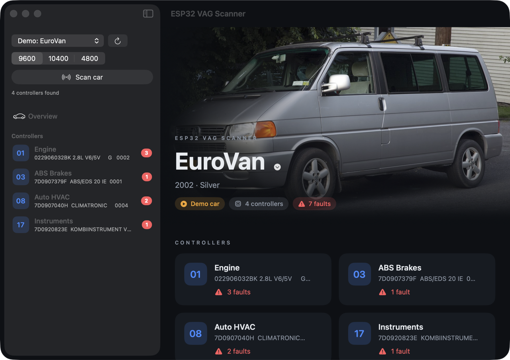
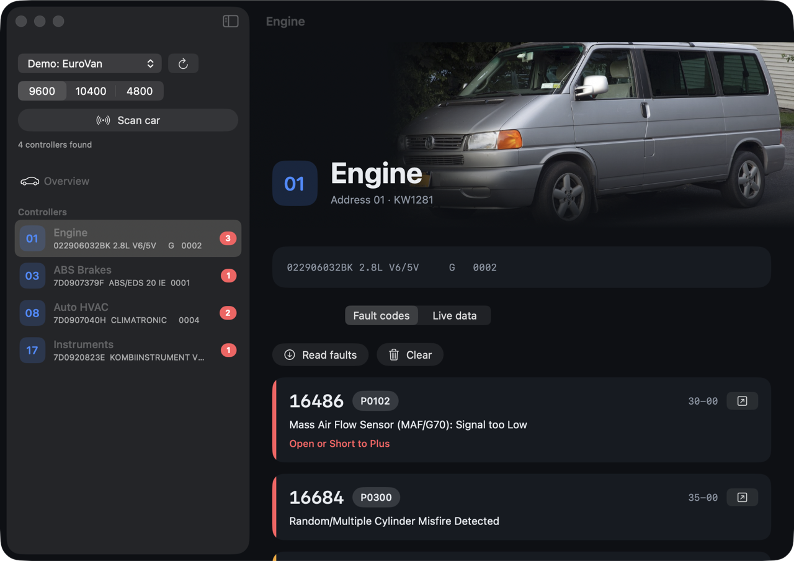
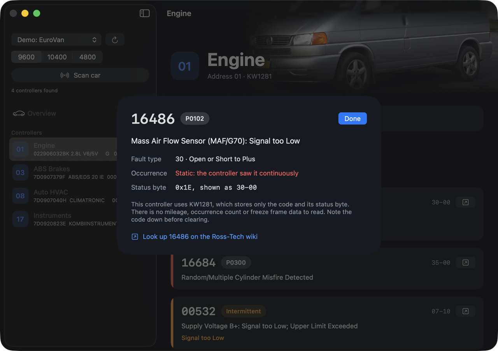
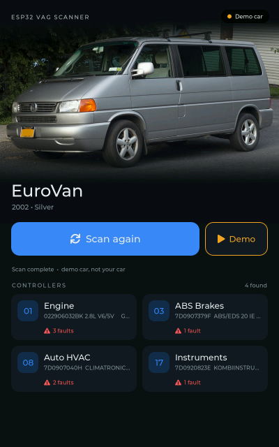
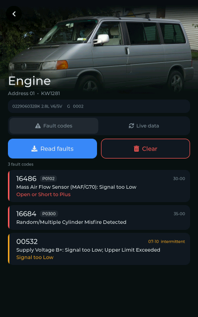
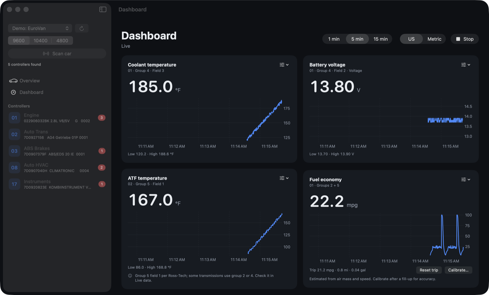
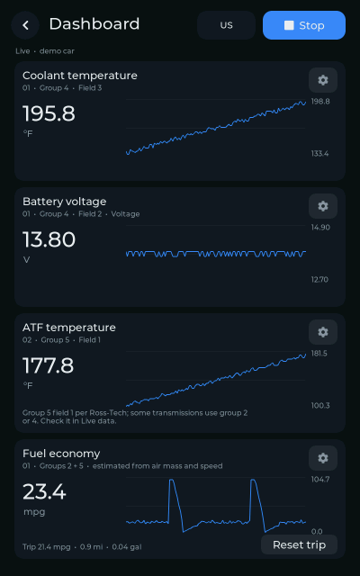
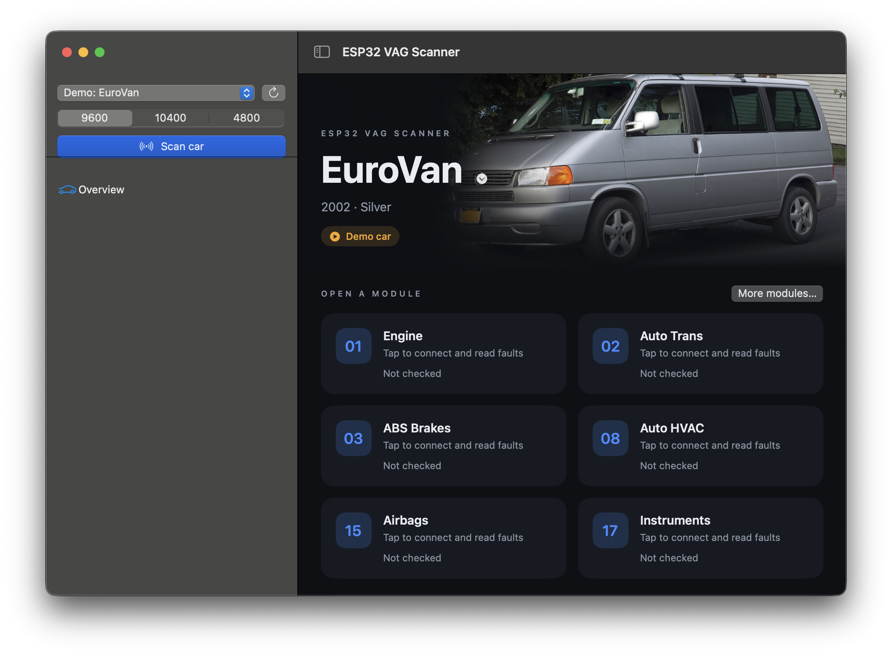

# ESP32 VAG Scanner

Read older VW and Audi controllers with a cheap KKL USB cable. Scan the car's modules, read
identification, read and clear fault codes, and watch live measuring blocks. It speaks
**KW1281**, the K-line protocol used by VAG cars from about 1990 to 2004.

There are two front ends, both driving the same cable with the same protocol core:

- **macOS**: a SwiftUI app.
- **ESP32-P4**: a standalone touch-screen unit (Guition JC8012P4A1C). The KKL cable plugs
  into the P4's USB port, with no wiring.

> **Status:** tested on a 2002 EuroVan from the Mac: the engine (Motronic ME7.1, 10400 baud)
> and the 01P automatic transmission (1200 baud) read identification, faults and live data.
> The P4 runs on hardware; its first real-car test is under way. Other cars and controllers
> are untested.

## Install on an ESP32-P4 (no tools needed)

Open the **[install page](https://wierzbickimc-prog.github.io/ESP32-VAG-Scanner/)** in Chrome or
Edge, connect the board's USB-serial port, and click **Install**. It uses
[ESP Web Tools](https://esphome.github.io/esp-web-tools/). Each GitHub release builds the firmware
and updates the page automatically (`.github/workflows/firmware.yml`).

## Screenshots

### macOS

| Overview | Fault codes |
|---|---|
|  |  |

Click a fault for everything the controller stores about it:



### ESP32-P4

| Home | Fault codes |
|---|---|
|  |  |

### Dashboard

| macOS | ESP32-P4 |
|---|---|
|  |  |

All screenshots show the simulated EuroVan (demo mode).

## Features

- Open a module directly from the landing screen and automatically read its fault codes,
  without scanning the car first. Both apps show **01 Engine**, **02 Transmission**,
  **03 ABS**, **08 HVAC**, **15 Airbags**, and **17 Instruments**, with **More modules** for
  the remaining known addresses. Identification and faults use one connection.
- Scan for controllers (common addresses, or all of 01-7F).
- Controller identification (part number, component, coding).
- Fault codes with descriptions, OBD-II P-codes, the fault type ("Short to Ground") and the
  intermittent flag. Clearing asks for confirmation first.
- Live measuring blocks, with standard VW labels where known.
- A **four-slot dashboard** with live values and trend charts. The EuroVan default shows
  coolant temperature, battery voltage, ATF temperature and fuel economy. Each slot can show
  a preset, or any field you pin from a controller's Live data (the pin button on the Mac;
  tap the value on the P4). US or metric units.
- Fault codes link to the **Ross-Tech wiki**. The Mac opens the page in the browser. The P4
  shows a QR code, and with **Wi-Fi** (through the board's ESP32-C6) reads the page itself.
- **Fuel economy** estimated from the engine's air mass and vehicle speed (VW standard groups
  2 and 5, assuming a stoichiometric mixture), with instant and trip average. On the Mac,
  **Calibrate** scales the estimate to match the fuel actually pumped at a fill-up.
- Recognises a few specific cars from their part numbers (T4 EuroVan, Mk3 Golf) and shows a
  matching photo.
- Demo mode with simulated cars, so you can try it without a car or cable.
- **EuroVan health checks** on both apps: a guided 01P ATF level assistant,
  AXK camshaft timing/chain assessment, misfire-counter monitoring and an ECU
  supply-voltage check. Each shows its prerequisites, readings, limitations and
  factory procedure source, and can save a local snapshot. See
  [procedures and validation status](docs/health-checks.md).

Connecting the cable does not start vehicle communication. Tap **Scan car** or a
module card to begin; the ESP32 also stays idle if its display cannot initialize.

The **Scan car** button still discovers controllers as before. Module cards start at
**Not checked** and update after a read; a missing controller shows **No response** rather
than a clean fault result. Not every car has every controller. Addresses use hexadecimal
notation (for example, **17** means instruments).



**Dashboard notes.** KW1281 talks to one controller at a time, and switching costs a 2–3 s
wake-up. The dashboard reads each controller several times before switching, so slots on
the engine update continuously while the transmission's ATF temperature updates every few
seconds. The ATF preset uses **02, group 5, field 1**, verified on the EuroVan's 01P.
Some other transmissions use group 2 or 4: open **02 Auto Trans → Live data**,
find the temperature, and pin it to the slot if it differs.
The fuel estimate can't see overrun fuel cut-off, so calibrate it after a fill-up.

KW1281 controllers store only a fault code and one status byte. There's no mileage,
occurrence count or freeze-frame data; that arrived with KWP2000 and UDS, which this tool
doesn't support.

**Health checks.** Open **Health checks** in the Mac sidebar or **EuroVan health
checks** on the P4 home screen. Choose a check, Start, then confirm the physical
conditions for that run. The ATF assistant requires a cold start around 30°C or
below and guides a physical overflow inspection at 35–45°C; the app cannot
measure fluid level. Timing screening applies the verified AXK intake limits and
shows the exhaust offset and difference as observations. It does not certify
chain or guide condition. Checks are restricted to engine `022906032AF` and
transmission `01P927733CG`; new health groups still await real-vehicle validation.

## Hardware

- A **KKL USB cable with an FTDI chip** (`0403:6001`, FT232R/BM). Tested cable: "USB <-> Serial",
  no serial number.
- For the standalone unit: a **Guition JC8012P4A1C** (ESP32-P4, 10.1" 800x1280 touch screen).

## Layout

| Path | What |
|---|---|
| [`kwcore/`](kwcore) | KW1281 protocol in plain C99, a simulated ECU, tests, and the `kwcli` command-line tool |
| [`mac/`](mac) | SwiftUI app. It links `kwcore` through symlinks in `Sources/KWCore` |
| [`esp32/`](esp32) | ESP-IDF project: USB host FTDI driver, LVGL UI. See [`esp32/README.md`](esp32/README.md) |
| [`hardware/kline-dongle/`](hardware/kline-dongle) | Unbuilt ESP32-C3 K-line dongle prototype; circuit, PCB, and assembly notes. Dedicated firmware is pending |
| [`assets/`](assets) | Car photos, measuring-block labels, and the scripts that build and fetch them |
| [`kw1281test/`](https://github.com/gmenounos/kw1281test) | Submodule: the upstream C# tool this protocol code is checked against |
| [`HANDOVER.md`](HANDOVER.md) | Design decisions, verified facts, and next steps |

## Build and run

```sh
git clone --recursive https://github.com/wierzbickimc-prog/ESP32-VAG-Scanner.git
cd ESP32-VAG-Scanner
```

**Protocol tests and command-line tool**

```sh
make -C kwcore test
make -C kwcore kwcli
kwcore/kwcli /dev/cu.usbserial-XXXX scan
kwcore/kwcli /dev/cu.usbserial-XXXX faults 01   # addresses are hex: 17 = instruments
KW_TRACE=1 kwcore/kwcli /dev/cu.usbserial-XXXX ident 01   # log every byte
```

**macOS app** (macOS 13+, Swift 5.9+)

```sh
cd mac
swift run ESP32VAGScanner                   # pick the cable in the app
swift run ESP32VAGScanner --demo            # straight into the simulated EuroVan
swift run ESP32VAGScanner --demo=golf --overview
swift run ESP32VAGScanner --demo --dashboard  # simulated EuroVan, dashboard running
swift run ESP32VAGScanner --demo --health     # EuroVan health-check screen
```

Direct-module integration tests use the simulated cars and require Xcode's XCTest framework:

```sh
DEVELOPER_DIR=/Applications/Xcode.app/Contents/Developer swift test --package-path mac
```

**ESP32-P4** (ESP-IDF v5.5.6)

```sh
. ~/esp/esp-idf-v5.5/export.sh
cd esp32
idf.py build
idf.py -p /dev/cu.usbserial-XXXX flash monitor   # the board's CH340 port
```

On the P4, hold **Scan** to open the demo cars. **Dashboard** sits between Scan and Demo. The
Wi-Fi button at the top opens the Wi-Fi screen; Wi-Fi is only used for the wiki viewer.

## Optional data (not in this repo)

Both apps work without these. With them, faults get descriptions and type text. Released P4
firmware includes the fault type names but never the Ross-Tech descriptions; it reads those
from the Ross-Tech wiki over Wi-Fi instead.

- **Fault descriptions:** a `code,meaning` CSV saved as `ross-tech-fault-codes.csv` in the repo
  root (the P4 build embeds it), and on the Mac as
  `~/Library/Application Support/ESP32 VAG Scanner/fault-codes.csv`.
- **Fault type names:** `python3 assets/tools/fetch_fault_types.py` downloads the list from
  [KLineKWP1281Lib_ESP32](https://github.com/domnulvlad/KLineKWP1281Lib_ESP32) (GPL-3.0) at a
  pinned commit into `kwcore/fault_types.h`. On the Mac, run `touch kwcore/fault_table.c` before
  the next build so it picks the file up.

## License

GNU General Public License v3.0 (see [`LICENSE`](LICENSE)): use it, share it, and change it
freely, and pass the same freedom on with anything you distribute. The fault type names come
from GPL-3.0 code. Bundled third-party parts keep their own licences (MIT and Apache-2.0, all
compatible), and the car photos are CC-licensed as listed in `assets/CREDITS.md`. Not affiliated
with Volkswagen or Ross-Tech.

## Credits

- Protocol behaviour follows [kw1281test](https://github.com/gmenounos/kw1281test) by Greg
  Menounos (MIT).
- Display and touch drivers are vendored from
  [chipguyhere/JC8012P4A1C_display](https://github.com/chipguyhere/JC8012P4A1C_display) (MIT).
- Fault type names come from [KLineKWP1281Lib_ESP32](https://github.com/domnulvlad/KLineKWP1281Lib_ESP32)
  by domnulvlad (GPL-3.0); header+body measuring-group formulas follow the same library.
- Car photos come from Wikimedia Commons; authors and licences are in
  [`assets/CREDITS.md`](assets/CREDITS.md) and shown in both apps.
