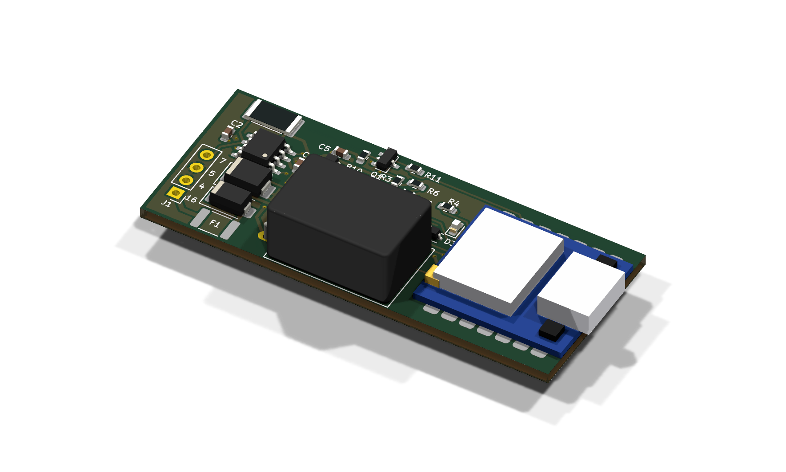
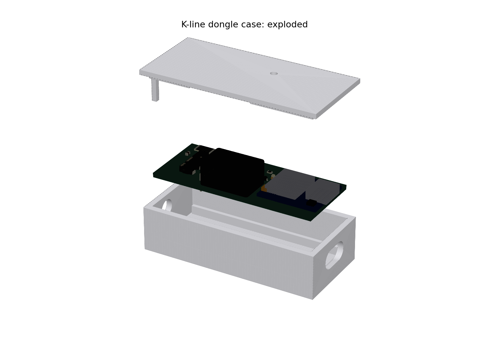
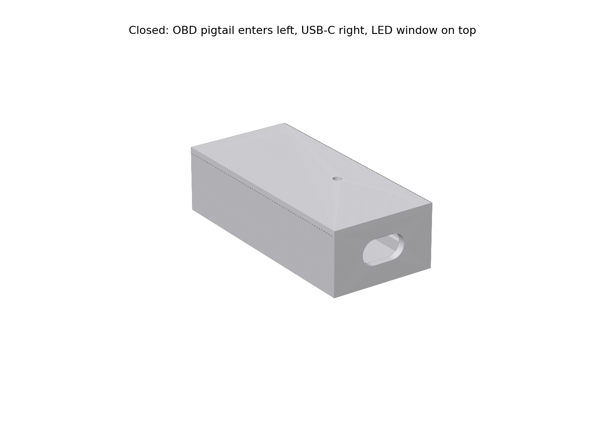

# K-line dongle (revision 3 prototype)

A 58 × 24 mm, two-layer carrier for a Seeed XIAO ESP32C3 and an ST L9637D
K-line transceiver, in a 3D-printed case. Open `kline-dongle.kicad_pro` in KiCad 10.



**Status: unbuilt prototype.** ERC, DRC and schematic parity are clean, and the case
has been checked against the board's 3D model. Nothing has been built. Bench
operation, case fit and tolerances, automotive transients, temperature and RF
performance are not validated. This is a **12 V vehicle design**: don't use it on a
24 V vehicle or assume it survives a 24 V jump start.

**Firmware is still required.** The repository's ESP32 firmware targets the P4
display and an FTDI cable; it does not run on this C3 dongle. A direct-UART `KwIo`,
battery measurement and a BLE/Wi-Fi link are still to be written. The pin table
below is their hardware interface.

## Revision 3 changes

- **U1 lies flat.** The upright R-78HB stood 17.5 mm tall; the horizontal
  R-78HB5.0-0.5L is 8.6 mm, so the populated board is about 10 mm tall.
- **No J2 jumper.** The XIAO is fed through D3, as Seeed recommends for the 5 V pad.
  USB can stay connected in the car; there is no shunt to fit or forget.
- **Simple battery sense.** A 100k/10k divider (0.11 mA) replaces the 10k/1k
  divider, zener, CBTLV switch and their resistors, which together drew about
  1.15 mA from the always-live OBD pin. GPIO6 is free.
- **R12 removed** (3.3 V bleed, 0.33 mA).
- Kept from revision 2: Q1/R10/R11 hold the K-line released while the ESP32 is off
  or resetting; U6 is the 5 V-tolerant RX buffer; D2 is SMBJ18CA.

## Assembly by Seeed Studio

Seeed supplies and assembles the complete populated board, including U1, the XIAO
and the antenna attachment. You only wire the OBD cable and fit the case. **J1 stays
unpopulated** as four plated wire holes. See [Seeed upload instructions](SEEED-ASSEMBLY.md)
and the [factory assembly/test notes](FACTORY-NOTES.md).

## USB and car power together

D3 keeps USB VBUS out of the 5 V converter, so USB can be plugged in while the dongle
is on the car. The reverse is not blocked: with the car connected, the XIAO's 5 V pad
(about 4.7 V through D3) also appears on the USB cable's VBUS. A powered computer
holds VBUS at 5 V and nothing flows; a switched-off one may be back-fed. Use a
powered computer, or unplug the OBD cable, when debugging over USB.

## Case



A base and a lid, printed separately (`enclosure/base.stl`, `enclosure/lid.stl`,
already in print orientation). Outside: **63 × 29 × 17.4 mm**.

- The board drops onto two ledges along its long edges. The lid's lip fits inside
  the walls and its posts hold the board, the XIAO and the converter down.
- **The car connects through an OBD-II male pigtail cable** (16-pin male plug with
  loose wires) entering the left end through a 6.5 mm hole. Solder plug pins 16, 4,
  5 and 7 to J1 (silkscreen labels). Put a zip tie round the cable just inside the
  wall as a strain-relief stop. A board this size with a 10 mm part doesn't fit
  inside a standard OBD plug shell.
- USB-C is open at the right end; a 2.5 mm hole over D5 shows the status LED.
- Stick the XIAO's flexible antenna inside the lid, away from the converter.
- The lid is a press fit. Clearance is 0.2 mm per side (`LIP_CLR`); add tape or a drop
  of glue if it rattles, or adjust and reprint.
- PETG or ASA: PLA softens in a parked car.



To change the case, edit the parameters at the top of `enclosure/enclosure.py`
(cable diameter, clearances, wall thickness). It reads part positions from
`gen/place.py`, so the openings follow the board.

```sh
cd enclosure
python3 -m pip install manifold3d numpy trimesh matplotlib
python3 enclosure.py                       # base.stl, lid.stl
kicad-cli pcb export glb --subst-models -o board.glb ../kline-dongle.kicad_pcb
python3 render.py board.glb                # renders/*.png
```

## Files and regeneration

| File | Purpose |
|---|---|
| `kline-dongle.kicad_sch` / `.kicad_pcb` | Schematic and routed board |
| `dongle.kicad_sym`, `sym-lib-table` | Project symbols |
| `dongle.pretty/`, `fp-lib-table` | Local XIAO footprint with carrier-compatible silkscreen |
| `dongle.3dshapes/XIAO_ESP32C3.wrl` | Approximate XIAO 3D model (from `gen/xiao_model.py`) |
| `gen/parts.py`, `gen/place.py` | Parts, connections and placement source |
| `gen/build_sch.py`, `gen/build_pcb.py` | Schematic and PCB generators |
| `gen/check_export.py` | ERC, DRC/parity, Seeed BOM/CPL and upload ZIPs |
| `enclosure/` | Case generator, STLs and renders |
| `SEEED-ASSEMBLY.md`, `FACTORY-NOTES.md` | Upload and factory assembly/test instructions |
| `build/` | Generated reports and manufacturing files; ignored by Git |

Run from this directory:

```sh
python3 gen/build_sch.py
/Applications/KiCad/KiCad.app/Contents/Frameworks/Python.framework/Versions/3.9/bin/python3 gen/build_pcb.py
python3 gen/check_export.py
```

`build_pcb.py` needs KiCad's `pcbnew` and `wx` Python modules. On other systems,
use their KiCad Python interpreter and set `KICAD_FOOTPRINT_DIR` to the installed
footprint directory if needed. `KICAD_CLI` can override the CLI executable. If a
net fails to route, set `KLINE_DEBUG_PCB=/tmp/debug.kicad_pcb` to save the partial
board for inspection.

Regeneration overwrites schematic/PCB edits. Make changes in the generators, or stop
regenerating once you start editing the design by hand. Always run the checks after
regeneration; a completed route is not electrical validation.

## Bill of materials

Use the exact ICs/packages specified; AHCT, LVC and LIN devices are not
interchangeable. `build/fabrication/bom-detail.csv` includes references and datasheets.

| Ref | Part / specification | Package | Notes |
|---|---|---|---|
| U1 | RECOM R-78HB5.0-0.5L | SIP-3, horizontal | 9–72 V in; 5 V, 0.5 A out; 8.6 mm above the board |
| U2 | ST L9637D | SOIC-8, 3.9 × 4.9 mm | No TX timeout; LIN transceivers can truncate the 5-baud wake-up |
| U3 | TI SN74AHCT1G125DBVR | SOT-23-5 | TX level shift |
| U4 | Seeed XIAO ESP32C3 | Castellated module | Include its external U.FL antenna |
| U6 | TI SN74LVC1G17DCKR | SC70-5 | 5 V tolerant RX buffer, Ioff protection |
| F1 | Bourns MF-MSMF050/60X-2 | 1812 | 0.5 A hold, 60 V, maximum fault current 10 A |
| D1 | SS16, 60 V / 1 A | SMA | Reverse polarity |
| D2 | Diodes Inc. SMBJ18CA | SMB | 18 V bidirectional TVS, 29.2 V maximum clamp |
| D3 | B5819WS, 40 V / 1 A | SOD-323 | Keeps USB VBUS out of the converter |
| D5 | Green LED | 0603 | Status |
| Q1 | Diodes Inc. BSS138-7-F | SOT-23 | TX buffer enable: pad 1 gate, 2 source, 3 drain |
| R1 | 510 Ω, 1 W | 2512 | K-line pull-up; about 0.5 W with 16 V across it |
| R3, R7, R10 | 10 kΩ, 1% | 0603 | |
| R4 | 1 kΩ, 1% | 0603 | |
| R6 | 100 kΩ, 1% | 0603 | Battery divider, upper |
| R11 | 100 kΩ, 1% | 0603 | Q1 gate pull-down |
| C1 | 10 µF, 50 V, X7R | 1210 | |
| C2 | 100 nF, 50 V, X7R | 0603 | U2 VS decoupling |
| C3 | 10 µF, 10 V, X7R | 0805 | Converter output |
| C4, C5, C6, C8 | 100 nF, 25 V, X7R | 0603 | Decoupling / ADC filter |
| J1 | Bare wire holes; no header | 2.54 mm through-hole | OBD pigtail wires: 16, 4, 5, 7 |
| TP1–TP8 | PCB copper only | Back-side 1 mm pads | No purchased component |

The local XIAO footprint derives from KiCad's `RF_Module:MCU_Seeed_ESP32C3`
(CC BY-SA 4.0 with the KiCad libraries exception); its front silkscreen is adapted
for this carrier. Its unused underside pads remain isolated copper islands.

## MCU interface and battery calculation

| GPIO | XIAO pad | Use |
|---|---|---|
| 4 | D2 | UART1 TX; R3 holds it high during reset |
| 5 | D3 | UART1 RX, including the local TX echo |
| 3 | D1 | ADC1 channel 3 battery sense |
| 7 | D5 | `TX_EN`: HIGH enables U3 through Q1; reset/LOW releases the K-line |
| 10 | D10 | Status LED |
| 6 | D4 | Free |

Firmware must keep GPIO7 low until UART1 is configured with TX idle high, then set
GPIO7 high to enable TX. Return GPIO7 low before sleep.

```text
VBAT = calibrated_ADC_volts × 11      (100k / 10k)
```

12.6 V reads 1.15 V; the TVS's 29.2 V maximum clamp reads 2.65 V, inside the ADC
pin's rating, and R6 limits any fault current into the pin. Use the ESP32-C3's
calibrated ADC conversion with 11 dB attenuation. VBAT is measured **after D1**, so
the OBD supply is higher by D1's load-dependent drop.

The 5-baud wake-up drives GPIO4 directly as a GPIO for its 200 ms bits, then hands
the pin back to UART1. USB Serial/JTAG is for programming and debugging, not an
FTDI-compatible cable endpoint.

## Fabrication constraints

2-layer FR-4, 1.6 mm, 1 oz finished copper, 0.2 mm minimum track/clearance, 0.3 mm
via drill, 0.6 mm via diameter, 0.5 mm copper-to-edge. The USB-C/module courtyard
overhang past the board edge is intentional. `check_export.py` fails on any ERC/DRC
warning, schematic parity issue or BOM/placement mismatch before exporting Gerbers,
drill files, the Seeed BOM/CPL, PDFs and factory instructions. The exports are
prototype artifacts, not proof that the design is qualified.

## Bring-up and outstanding validation

1. USB disconnected. Apply a 12 V bench supply at J1, current-limited to 250 mA.
   Check 5 V at TP2, 3.3 V at TP3, TP8 ≈ TP1/11, and K-line idle high at TP4.
2. Flash bring-up firmware over USB (bench power may stay on). Verify TX/K/RX levels,
   5-baud timing, echo, baud changes and the ADC scaling against a meter.
3. Verify the K-line stays released during reset, bootloader entry, sleep and power
   transitions. On these VWs the immobilizer can share the K-line: confirm the
   engine starts with the dongle plugged in, in every state.
4. Run the fake-ECU loopback with a powered KKL cable and common ground, then a
   controlled vehicle test after the bench checks pass.
5. Print the case and check the fit, the USB plug and the LED window.

U1 needs at least 9 V after D1, so cranking may reset the dongle. OBD pin 16 is
always live: the converter's and transceiver's quiescent current, plus 0.11 mA for
the divider, flow even while the ESP32 sleeps. Measure it, and unplug the dongle for
long storage.

Surge/load-dump energy, TVS temperature, PTC fault coordination, D1 reverse-voltage
margin, K-line ESD and emissions have not been tested against automotive pulse
requirements. A 600 W TVS's short-pulse rating does not prove survival of a long
load dump.

## Primary references

- [ST L9637 pinout, thresholds and limits](https://www.st.com/resource/en/datasheet/l9637.pdf)
- [Diodes SMBJ18CA ratings](https://www.diodes.com/part/view/SMBJ18CA)
- [Bourns MF-MSMF fuse ratings and derating](https://www.bourns.com/docs/product-datasheets/mf-msmf.pdf)
- [RECOM R-78HB-0.5L dimensions and application guidance](https://www.recom-power.com/pdf/Innoline/R-78HBxx-0.5_L.pdf)
- [Seeed XIAO ESP32C3 power circuit](https://files.seeedstudio.com/wiki/XIAO_WiFi/Resources/Seeeduino-XIAO-ESP32C3-SCH.pdf)
- [Espressif ESP32-C3 ADC and electrical limits](https://www.espressif.com/sites/default/files/documentation/esp32-c3_datasheet_en.pdf)
